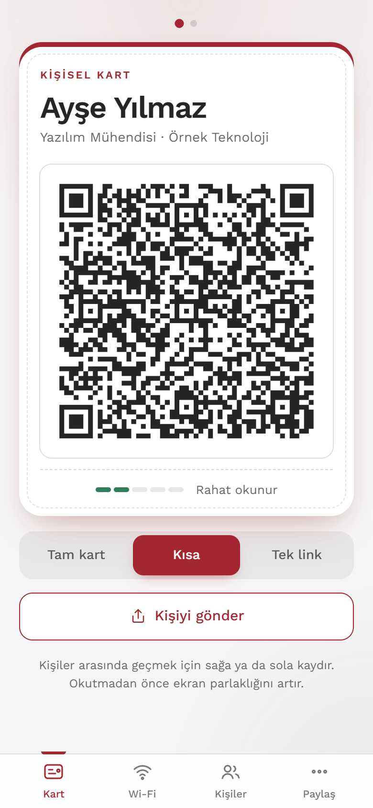
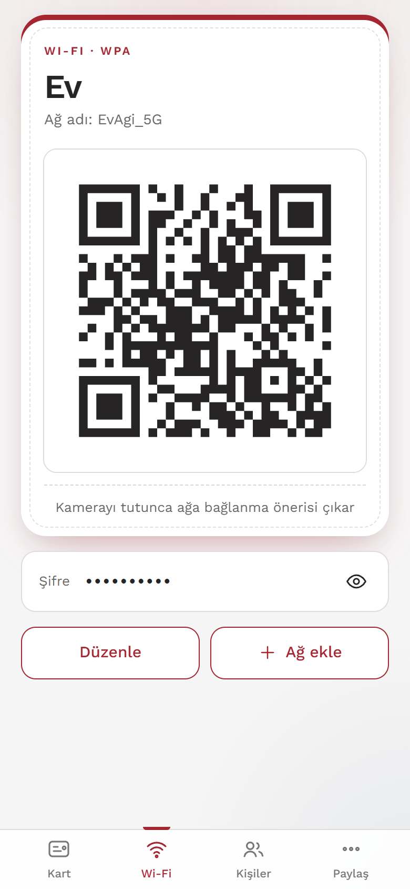
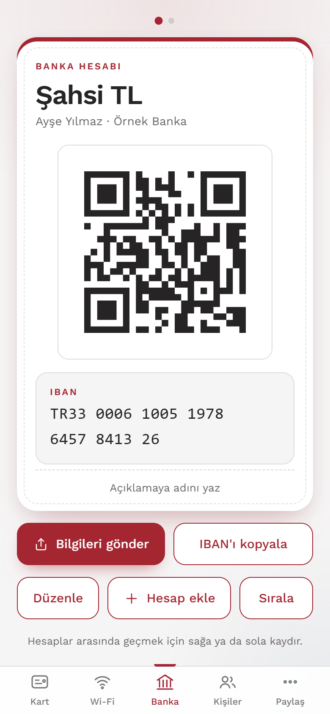
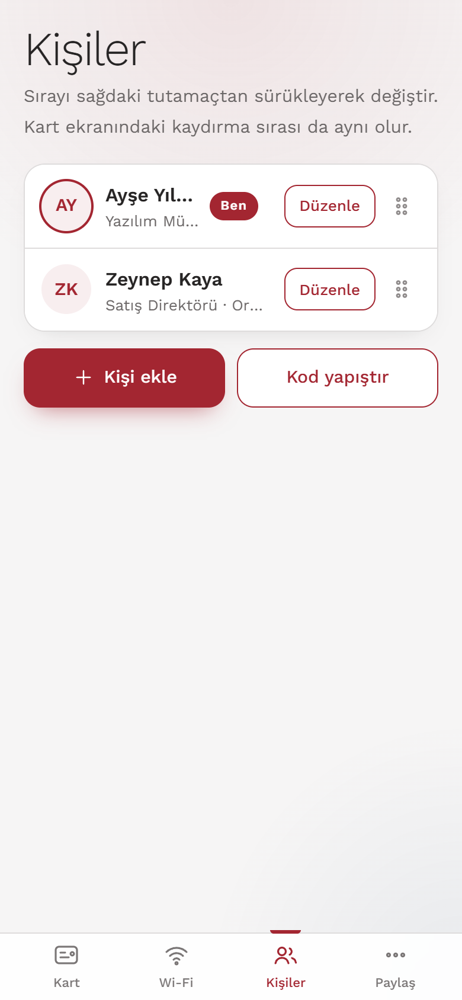

# Kontak QR

QR kodla kartvizit, arkadaş kartları ve Wi-Fi paylaşımı. Hesap yok, sunucu yok, abonelik yok. Bilgiler yalnızca kendi telefonunda saklanır, ana ekrana eklenince internetsiz çalışır.

**Canlı uygulama:** https://sokrateng.github.io/kontak-qr/

<p>
  
  
  
  
</p>

Ekran görüntülerindeki kişiler kurgusaldır.

## Neden

Etkinliklerde basılı kartvizit vermek yerine telefonunu göstermek, evdeki misafire Wi-Fi şifresini yazdırmak yerine QR okutmak. iPhone'un kendi kamerası QR'ı okur ve "Kişilere ekle" ya da "Ağa bağlan" önerir. Karşı tarafın uygulama kurması ya da internete bağlı olması gerekmez.

## Özellikler

- **Kartvizit QR'ı:** vCard 3.0 olarak ad, firma, pozisyon, telefon, e-posta, web, adres ve linkler. Üç mod var: **Tam kart**, **Kısa** (ad, firma, telefon, e-posta) ve **Tek link** (yalnızca LinkedIn, X, WhatsApp, web ya da bir konum).
- **Birden fazla konum:** kişi başına İş, Ev, Şube gibi adlandırılmış konumlar. Harita linki ya da düz adres yazılır. Her konum Tek link modunda kendi QR'ını verir, tam kartta etiketli link olarak rehbere düşer. Konum satırında üç yardımcı var: **Haritada seç** (Google Maps'i açar, orada Paylaş, Kopyala, sonra **Yapıştır**), **Konumum** (telefonun GPS'inden bulunduğun yerin linkini üretir) ve düz adres yazma. Haritaya geçerken form taslak olarak saklanır, iOS uygulamayı bellekten atsa bile dönüşte geri gelir.
- **Tam kartta paylaşılacaklar:** Kişinin formunda pozisyon, telefon, e-posta, web, adres, LinkedIn, X ve WhatsApp için ayrı ayrı anahtarlar, her konum satırında da "Tam kartta paylaş" kutusu vardır. İşaretsiz olanlar Tam kart ve Kısa QR'a, bir de "Kişiyi gönder"e girmez. Tek link modunda yine seçilebilir. Telefon çıkarılırsa telefondan üretilen WhatsApp linki de çıkar (`wa.me/<numara>` numarayı ele verir). Ad ve firma her zaman kartta kalır. Örnek: Ev konumunu kartta paylaşmamak.
- **Banka hesapları:** başlık, hesap sahibi, banka, IBAN ve açıklama. IBAN mod-97 ile doğrulanır, yanlış IBAN kaydedilmez. Tek dokunuşla kopyala, "Bilgileri gönder" ile okunabilir mesaj olarak paylaş. IBAN hiçbir QR'a ya da kart mesajına girmez.
- **Okunabilirlik göstergesi:** QR sıklaştıkça uyarır, kısa moda geçmeyi önerir.
- **Wi-Fi QR'ı:** birden fazla ağ, gizli şifre (göz simgesiyle gösterilir), WPA/WEP/açık ağ.
- **Birden fazla kişi, ağ ve hesap:** Kart, Wi-Fi ve Banka ekranlarında sağa sola kaydırarak geçilir.
- **Sürükleyerek sıralama:** kişiler, Wi-Fi ağları ve banka hesapları. Sıra, kaydırma sırasıyla birebir aynıdır.
- **Kişiyi gönder:** ekrandaki moda göre (Tek link, Kısa, Tam kart) paylaşım menüsünden okunabilir mesaj ya da kişi dosyası (.vcf) gönderir.
- **Rehberden ekle:** iPhone Rehber'den dışa aktarılan `.vcf` dosyalarını okur (iOS Rehber, Android, vCard 2.1/3.0/4.0).
- **Link temizleme:** LinkedIn ve X linklerindeki takip parametrelerini (`?utm_...`) atar, QR kısalır.
- **Yedek:** tüm bilgileri tek kodla dışa aktar, geri yükle.
- **Çevrimdışı ve kendiliğinden güncellenen:** internet varken her açılışta en yeni sürümü alır, yoksa kayıtlı kopyadan açılır.

## iPhone'a kurulum

1. Safari'de canlı adresi aç.
2. Paylaş düğmesi, **Ana Ekrana Ekle**.
3. Ana ekrandaki simgeden aç.

## Gizlilik

- Hiçbir bilgi bir sunucuya gönderilmez. Kartlar, Wi-Fi şifreleri, IBAN'lar ve ayarlar tarayıcının `localStorage` alanında şifresiz saklanır. Telefonun kilidi bu bilgilerin tek koruması olur.
- Yedek kodu (`KQR1:...`) şifreli değil, yalnızca base64'tür. Wi-Fi şifrelerini ve banka hesaplarını içerir. Güvenmediğin birine gönderme.
- Uygulama dışarıya yalnızca kendi dosyalarını (HTML, simgeler) indirir. Yazı tipi ve QR kütüphanesi uygulamanın içine gömülüdür, üçüncü taraf istek yapılmaz.

## Nasıl çalışır

- **vCard:** `BEGIN:VCARD ... END:VCARD`. LinkedIn, X, WhatsApp gibi linkler etiketli `URL` satırlarıdır (`itemN.URL` ve `itemN.X-ABLabel`). Türkçe karakterler UTF-8 olarak kodlanır.
- **Wi-Fi:** `WIFI:T:WPA;S:ağ_adı;P:şifre;;` standart biçimi. Özel karakterler (`\ ; , : "`) kaçırılır.
- **QR:** [qrcode-generator](https://github.com/kazuhikoarase/qrcode-generator). Kütüphane varsayılan olarak Türkçe karakterleri bozduğu için baytlar `TextEncoder` ile UTF-8'e çevrilir. Testler üretilen QR'ı jsQR ile geri okuyup içeriğin birebir aynı çıktığını doğrular.
- **Konumlar:** "İş" gibi başlık "İş konumu" etiketine çevrilir. Düz adres `https://www.google.com/maps/search/?api=1&query=...` linkine, harita linki olduğu gibi kullanılır. Eski sürümdeki tek konum alanı ilk konuma taşınır.
- **IBAN:** `normalizeIban`, `formatIban` ve `isValidIban` (ISO 13616 mod-97, Türk IBAN'ı için 26 karakter). Kopyalarken boşluksuz, mesajda 4'lü gruplarla yazılır.
- **Tek link modu ve WhatsApp:** telefon numarasından `https://wa.me/<numara>` üretilir. İstenirse WhatsApp'ın kullanıcı adı için verdiği link olduğu gibi kullanılır.
- **Kişi paylaşımı:** iOS 15 ve üstünde `navigator.share` ile .vcf dosyası, iOS 14'te okunabilir metin gönderilir.

## Bilinen sınırlar

- iOS 14'te paylaşım menüsüyle dosya gönderilemez, bu yüzden "Kişiyi gönder" metin olarak gider.
- Web uygulaması Wi-Fi ağlarını tarayamaz, kayıtlı ağları ya da şifreleri okuyamaz. Ağlar elle girilir.
- iPhone Safari'de rehbere doğrudan erişim (Contact Picker) yoktur. Bunun yerine `.vcf` dosyası seçilir.
- Ekran uyanık tutma (Wake Lock) iOS 14'te yoktur. QR gösterirken ekran kararabilir.
- Çok küçük ekranlarda (320 px genişlik) içerik sığmazsa Kart ve Wi-Fi sayfaları kaydırılabilir kalır.
- Safari sekmesinde ekranın kenarından başlayan kaydırma geri gitme hareketi sayılır. Ana ekrandan açılan uygulamada sorun olmaz.
- Konum satırındaki **Yapıştır** (panodan okuma) ve **Konumum** (GPS) düğmeleri iOS'un izin sorularına bağlıdır. Çalışmazsa linki alana elle yapıştırmak ya da adres yazmak yeterlidir. Gerçek bir iPhone'da doğrulanmamıştır.
- WhatsApp kullanıcı adı linki alanı, WhatsApp'ın link biçimine bağlıdır ve gerçek bir kullanıcı adı linkiyle doğrulanmamıştır.

## Geliştirme

Gereksinim: Node.js 22.18 ya da üstü (testler TypeScript dosyalarını doğrudan çalıştırır).

```bash
npm install
npm test            # birim testleri
npm run typecheck   # sıkı TypeScript kontrolü
npm run build       # docs/ klasörünü üretir
npm run serve       # docs/ klasörünü http://localhost:3000 adresinde sunar
```

| Komut | Ne yapar |
|---|---|
| `node tools/e2e.mjs [url]` | Tarayıcıda uçtan uca test (form, kaydırma, sürükleme, içe aktarma, çevrimdışı açılış) |
| `node tools/shot-states.mjs <url> <genişlik> <yükseklik> <etiket>` | Tüm ekranların görüntüsünü alır |
| `node tools/make-icons.mjs` | `assets/` içindeki uygulama simgelerini üretir |

Tarayıcı araçları [puppeteer](https://pptr.dev) ister. `npm i -D puppeteer` ile kur ya da `PUPPETEER_MODULE` ortam değişkenine kendi `puppeteer.js` dosyanın tam yolunu ver.

### iOS 14 uyumu

Hedef Safari 14 olduğu için derleme `esbuild --target=safari14` ile yapılır. Dikkat edilen noktalar:

- Flex `gap` yok (14.0–14.4), yerine grid `gap` ya da kenar boşluğu kullanılır.
- `aspect-ratio`, `dvh`, `:focus-visible`, `inset`, `structuredClone`, `Array.prototype.at` kullanılmaz.
- Destructuring esbuild tarafından Safari 14 için dönüştürülemediğinden kullanılmaz.
- Güvenli alan için `env(safe-area-inset-*)`, giriş alanlarında yakınlaştırmayı önlemek için en az 16 px yazı boyutu.

## Proje yapısı

```
src/
  main.ts          olaylar, durum, paylaşım, sürükleme, kaydırma
  views.ts         Kart, Wi-Fi, Banka, Kişiler, Paylaş ekranları
  sheets.ts        formlar ve alt pencereler
  vcard.ts         vCard üretimi
  vcard-import.ts  .vcf okuma
  wifi.ts          Wi-Fi QR metni
  links.ts         telefon, LinkedIn, X, WhatsApp ve konum link kuralları
  iban.ts          IBAN doğrulama, biçimlendirme, hesap mesajı
  contact-text.ts  "Kişiyi gönder" mesajları
  codec.ts         yedek ve kart kodları (KQR1:)
  qr.ts            QR üretimi ve okunabilirlik
  order.ts         sıralama yardımcısı
  drag.ts          tutamaçla sürükleyerek sıralama
  store.ts         localStorage
  sw.ts            service worker
  template.html    sayfa ve CSS
tools/             uçtan uca test, ekran görüntüsü, simge aracı
assets/            uygulama simgeleri
docs/              derlenmiş uygulama (GitHub Pages buradan yayınlanır)
screenshots/       bu README'nin görselleri
```

## Yayınlama

Çıktı `docs/` klasörüdür. GitHub Pages bu klasörden yayınlanır (Settings, Pages, Branch: `main`, Folder: `/docs`).

```bash
npm run build
git add -A
git commit -m "..."
git push
```

Service worker ve "Ana Ekrana Ekle" için sayfanın https üzerinden sunulması gerekir (`localhost` istisnadır).

## Kullanılan açık kaynak

- [qrcode-generator](https://github.com/kazuhikoarase/qrcode-generator) (MIT), QR üretimi
- [Work Sans](https://github.com/weiweihuanghuang/Work-Sans) (SIL OFL 1.1), yazı tipi, uygulamaya gömülüdür
- [jsQR](https://github.com/cozmo/jsQR) (Apache-2.0), yalnızca testlerde
- [esbuild](https://esbuild.github.io) ve [TypeScript](https://www.typescriptlang.org), derleme

## Lisans

Henüz bir lisans dosyası eklenmedi.
